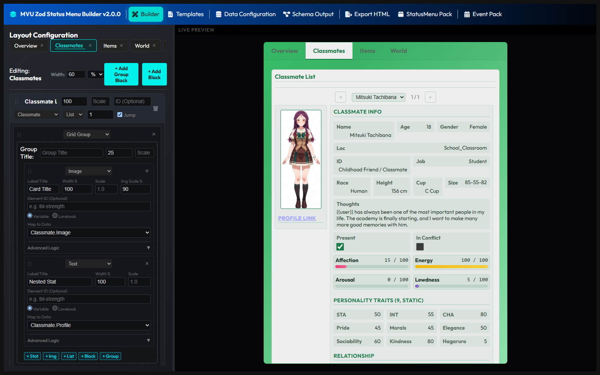

# MVU Zod Status Menu Builder v2

MVU Zod Status Menu Builder is a standalone app that runs in your browser. It builds the parts of an MVU game that are not code: the status menu the player sees, the schema behind the variables, and event packs that add new story to a game.

Version 2 is built for [MVU Helper](https://github.com/KritBlade/mvu-helper) and its MVU Game Engine v2.0. What it exports is a pack that MVU Helper installs onto a card.  It doesn't work with MVU Game Maker.

  

## Getting started

1. Open [dist/index.html](dist/index.html) here on GitHub, and click the download button at the top right.
2. Double-click `index.html` to open it in your browser.
3. Click on Data Configuration tab if you have an existing layout want to import.  Otherwise you can start fresh by clicking on Load Default Data to populate sample data so that you can click on the Builder tab to start building.

That's it. The whole app is that one file. Nothing gets installed, and nothing is sent anywhere.

**The builder doesn't save on its own.** Close the browser tab, and your work is gone. So click **Export config**, at the top of the Data Configuration page, before you close it. Next time, **Import config** loads it back.

## What it builds

- **The status menu.** You draw it by click and drag, and point each cell at a variable. It exports as a StatusMenu Pack, which MVU Helper installs onto your card.
- **The schema.** You tick the variables your game keeps, and copy the Zod schema it writes for you.
- **Event packs.** You upload a game card, and build new events for it by clicking. No code at all.

## Why it's a standalone app

A game has a lot of jobs in it. Somebody codes the game engine. Somebody draws the status menu. Somebody writes new events.

The person who draws the menu or writes the events doesn't need to read the engine's code. They only need to know which data the game keeps. So the builder takes the game's data, and only offers what that game has.

It's like an interior designer working from the floor plan. They need to know where the rooms are. They don't need to know how the plumbing works.

## Documentation

Every page, every button and the order to use them in: [How to use MVU Zod Status Menu Builder](doc/README.md).

What the packs do once they're installed is on MVU Helper's side:

- [What is Status Menu Engine](https://github.com/KritBlade/mvu-helper/blob/main/doc/statusmenu_engine/README.md)
- [Schema](https://github.com/KritBlade/mvu-helper/blob/main/doc/gamelogic_engine/schema.md)
- [What is EventPack Engine](https://github.com/KritBlade/mvu-helper/blob/main/doc/eventpack_engine/README.md)

## What changed from v1.0

- **A new look.** The pages sit in a top bar, in 4 groups: Menu, Data, Export and Events. Every replace or delete asks first.
- **The StatusMenu Pack page is new.** A menu ships as a pack that MVU Helper installs, instead of an HTML regex you paste by hand.
- **The Event Pack page is new.** Build events for any card whose engine hosts event packs.
- **The Logic tab is gone.** What a button does now lives in the menu's own engine file, `statusMenuLogic.cjs`. Equip and unequip are actions in there.
- **The Action Button cell is new.** A list can also put its own buttons on every row, and a Checkbox can be read only.
- **Cell formulas moved out of the layout.** On export, each formula becomes a named function in `layoutFormatters.cjs`, and the layout only keeps its name.

Version 1.0 is still here as [dist/old-version/index-1.0.html](dist/old-version/index-1.0.html), if you need it for [mvu-game-maker](https://github.com/KritBlade/MVU_Game_Maker).

## What your game card needs

The builder needs nothing to run. The packs it makes need MVU Helper in SillyTavern, which rides on Tavern Helper, ST-Prompt-Template and MVU. The install steps are on [Install MVU Helper](https://github.com/KritBlade/mvu-helper/blob/main/doc/install.md).

## FAQ

**The menu in SillyTavern doesn't look like the builder's preview.** Go to the **Templates** page. In the **Global CSS and locale** card, open **Global CSS**, and click **Reset to default**. A project made with an older version keeps its old CSS until you do.
