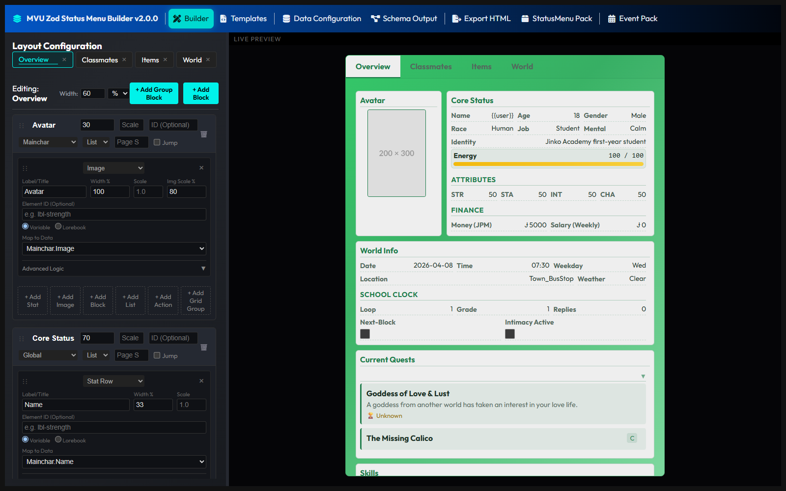
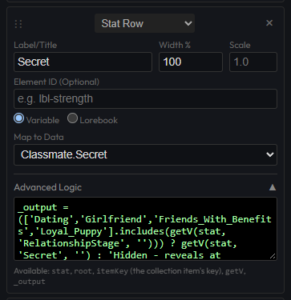

# The Builder page

The Builder page is where you draw the status menu, by click and drag. The live preview next to it draws the menu with your sample data as you go.



A menu has 3 levels. **Tabs** are what the player flips between in the menu. **Blocks** are the boxes on a tab. **Cells** are the lines inside a box: a stat, a bar, a picture, a list.

Think of a binder. The tabs split it into sections, each section has a few boxes on it, and each box has a few lines written in it.

## Tabs

The row at the top lists your tabs. **+** adds one. Click a tab to work on it, and its name turns into a box you can rename it in. Drag a tab to move it, and **×** removes it. The last tab can't be removed.

Next to the name, **Width** sets how wide the menu is on that tab, in `%` or `px`.

## Blocks

**+ Add Block** adds a box to the tab. **+ Add Group Block** adds a box with a Grid Group already inside it. Drag a block by its handle to move it.

| Box | What it does |
| --- | --- |
| **Block Title** | the header of the box |
| **Width %** | how much of the row it takes. 50 puts 2 blocks side by side. 100 by default |
| **Scale** | the font size, 1.0 by default |
| **ID (Optional)** | a name for the box, if you style it in CSS |
| **Global** or a variable | **Global** reads the whole data. A list here makes the block repeat once per member |
| **List** or **Grid** | how the cells sit: one under the other, or in a grid |
| **Page Size** | how many members show at once, in a repeating block. 5 by default |
| **Jump** | adds a dropdown to jump straight to one member |

### A block that repeats

Say your cast is in `Classmate`, with one entry per heroine. You want one box per heroine, each showing her name and her affection.

Map a cell to `Classmate.Name`. The builder sees that `Classmate` is a Collection, and maps the block to it for you. Now the block repeats once per heroine, and each copy shows its own heroine's name.


That's why the data picker shows `Classmate.Name` and never `Classmate.Mitsuki.Name`. Inside a repeating block, a cell names the field, and the block fills in the member.

It only works when `Classmate` is ticked as a **Collection** on the [Schema Output](schema.md) page.

It works the other way too. Map a cell in that block to a variable outside every Collection, like `Mainchar.Money`, and the block goes back to **Global**. The block follows the last cell you mapped, so put the cast's cells in one block and everything else in another.

## Cells

The buttons under a block add cells: **+ Add Stat**, **+ Add Image**, **+ Add Block**, **+ Add List**, **+ Add Action** and **+ Add Grid Group**. Each cell then has a type you can change:

| Type | What it shows |
| --- | --- |
| **Stat Row** | a label and a value, like `Money 500` |
| **Stat Bar (HP)** | a bar that fills up, like Energy 70 out of 100. **Max Value Data** picks the variable it's out of, and **Bar Color** picks 1 of 10 colors |
| **List (Loop)** | every member of a list, like the inventory |
| **Image** | a picture from a URL in your data. **Img Scale %** sets its size |
| **Text** | a block of text: fixed, from a variable, or a formula's answer |
| **Grid Group** | a box of cells inside the block. Groups can hold other groups |
| **Action Button** | a button that runs an action from the menu's engine |
| **Checkbox** | a true or false variable, as a tick box |

Every cell has a **Label/Title**, **Width %**, **Scale** and an optional **Element ID**.

### Where a cell reads from

Most cells read a **Variable**. Pick it in **Map to Data**, from the list of every variable in your sample data.

A Stat Row, an Image or a Text can read a **Lorebook** entry instead. Type its key or its comment in **Lorebook Key(s)**, and the cell shows that entry's text. A world map image can live in the lorebook, and change without touching the save.

### Lists

A List cell shows every member of a list, like the items in the inventory. **Layout** picks how each member is drawn:

| Layout | Drawn as |
| --- | --- |
| **List** | one line per member |
| **Grid** | a grid of members |
| **Quest** | a quest log |
| **Inventory** | an inventory |
| **Equipment** | equipment slots |
| **Custom** | your own design, made on the [Templates](templates.md) page. Type its name next to it |

3 ticks change how the list behaves. **Collapse by default** starts it folded. **Allow Edit** lets the player open a member and edit its fields. **Allow Delete** puts a delete button on every row.

**Row actions** puts your own buttons on every row, as a list of buttons: `[ { "title": "⚔ Equip", "action": "equip" } ]`. Each one runs the named action for the member on that row. Add `"confirm": true` to ask the player first.

### Buttons and checkboxes

An **Action Button** only names an action, in **Action**. **Args** is extra data sent with the click, as JSON, like `{ "amount": 1 }`. What the action actually does is written in the menu's engine file, `statusMenuLogic.cjs`, by whoever codes the menu.

Same goes for the other clicks. A **Checkbox** the player can tick, **Allow Edit** and **Allow Delete** each send an action too. The menu's engine has to have it, or the click is refused. The starter engine the builder gives you has no actions at all. ArtificKoi's has all of them.

So the designer decides where the buttons go, and the coder decides what they do. How to write an action is on [The menu engine](https://github.com/KritBlade/mvu-helper/blob/main/doc/statusmenu_engine/engine.md).

Tick **Read only** on a Checkbox to only show the value, with no click at all.

## Advanced Logic

A Stat Row, an Image or a Text can run a formula instead of showing the variable as it is. Open **Advanced Logic** under the cell, and write a line of JavaScript that puts its answer in `_output`.

It starts with a formula that just reads the variable:

```js
_output = getV(root, 'Mainchar.Money', 'Default');
```

Here's what you can use in a formula:

| Name | What it is |
| --- | --- |
| `root` | the whole data |
| `stat` | the member this cell belongs to, inside a repeating block |
| `itemKey` | that member's key, like `Mitsuki` |
| `getV(from, path, fallback)` | reads a variable, and takes the value out of a value and label pair |
| `_output` | what the cell shows |

A real one, ArtificKoi's Secret cell. A heroine's secret only shows once you're dating her:



```js
_output = (['Dating','Girlfriend','Friends_With_Benefits','Loyal_Puppy'].includes(getV(stat, 'RelationshipStage', ''))) ? getV(stat, 'Secret', '') : 'Hidden - reveals at Dating+';
```

A Lorebook cell's formula gives back the entry's key instead. So a map can change as the player levels up:

```js
_output = getV(root, 'Mainchar.Level', 0) > 70 ? 'post-70-map' : 'pre-70-map';
```

In the game, a formula runs in the same locked sandbox as the game engine. It can read the data, and that's all. No page, no network, no buttons.

When you export, every formula becomes its own named function in `layoutFormatters.cjs`, named after the cell's variable: `Mainchar.Money` becomes `maincharMoney`. So when you change a cell's variable, its function's name changes with it. A formula that's only fixed text, like `_output = 'Status';`, becomes plain text instead.

[Back to How to use MVU Zod Status Menu Builder](README.md)
