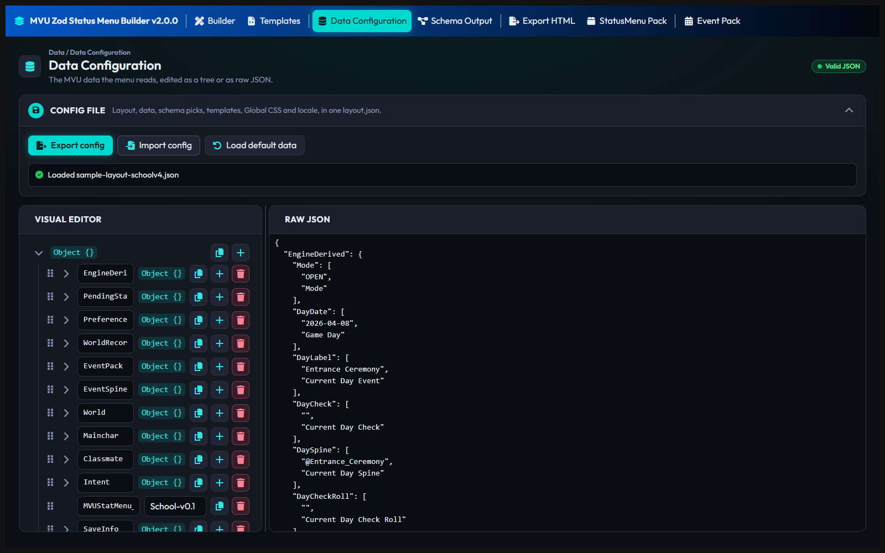

# Data Configuration

The Data Configuration page holds your sample data: one copy of the game's `stat_data`, the variables MVU keeps for the game.

The rest of the builder reads it. The Builder page's data picker lists its variables, the live preview draws with its values, and the Schema Output page builds its tree from it.

Think of a tailor's mannequin. You fit the clothes on the mannequin, not on a customer. The sample data is your mannequin. The real player's data looks the same, just with different numbers.

## The Config file card

The card at the top has 3 buttons:

| Button | What it does |
| --- | --- |
| **Export config** | downloads your whole project as `layout.json` |
| **Import config** | loads a project file back. It replaces everything, so it asks first |
| **Load default data** | puts in a small sample game, a quick way to try the builder. It replaces your data, so it asks first |

More on the project file is on [Save your work](README.md#save-your-work).

## Edit it 2 ways

The page shows the same data twice, side by side:

- **Visual editor.** The data as a tree. Add, remove and change values by clicking.
- **Raw JSON.** The data as text. Paste a whole `stat_data` in here.

Change one, and the other follows. Drag the divider between them to resize, or click it and use the arrow keys.

The label at the top says where you stand: **No data**, **Valid JSON** or **Invalid JSON**. While the text has a mistake, Raw JSON says what's wrong, and the Visual editor waits until you fix it there.

## Value and label pairs

A lot of MVU games keep each value together with its label, as a pair: `"Time": ["8:00", "Time"]`. The first one is the value, the second one is its label.

The builder understands both kinds. A pair shows up as one variable in the data picker, `World.Time`, never as 2 separate pieces. A plain value, like `"Money": 500`, works the same way.

## Use real data

Make the sample look like the real game. Same names, same structure, and at least 1 member in every list.

When you export, the builder runs every formula against this sample. A formula that crashes, or gives back nothing, shows up as a warning before it ever reaches a player. A sample with an empty cast can't test the cells that read the cast.

[Back to How to use MVU Zod Status Menu Builder](README.md)
