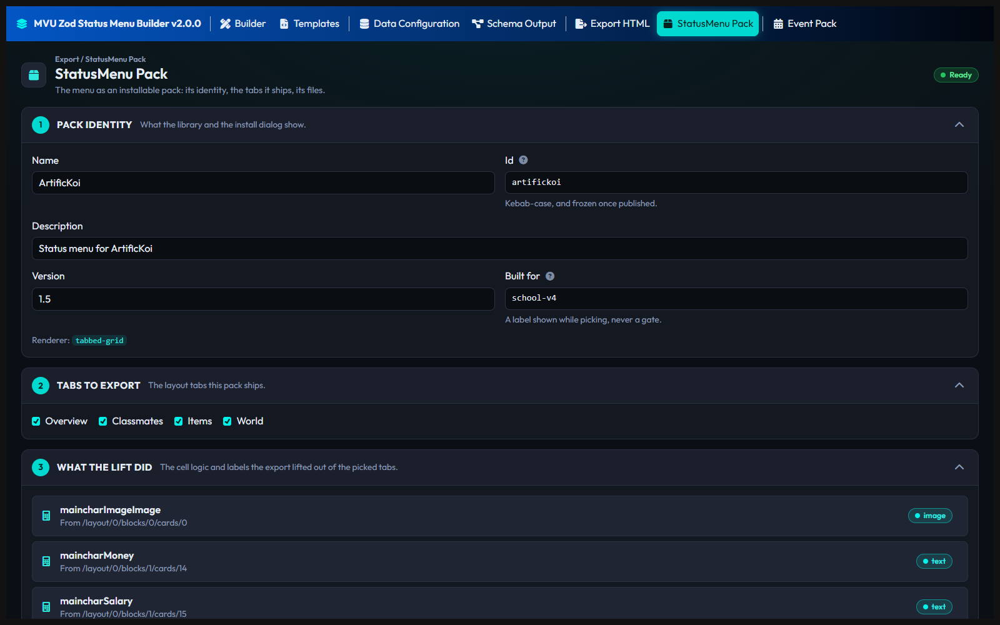
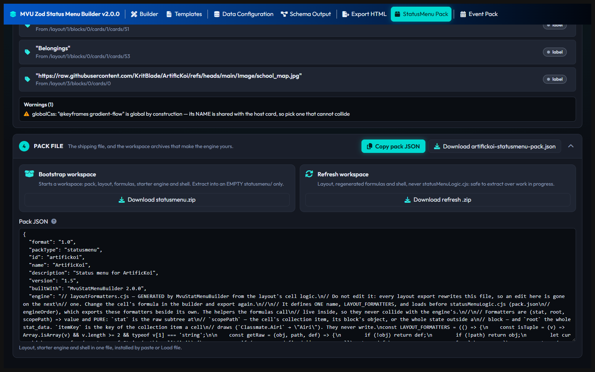

# Export your menu

The StatusMenu Pack page turns your menu into a pack that MVU Helper installs onto a card. The Export HTML page gives you the same menu as one HTML document, for a quick look or test. Only the pack is meant to ship.

## The StatusMenu Pack page

Fill it in from the top down. The label at the top says where you stand:

- **Ready**: the pack can be exported, and the export buttons are awake.
- **Refused**: something can't be exported. The **Refused** list says what, like a missing Id or no tab ticked.
- **Not ready**: nothing is refused, but the menu's shell couldn't be built. A notice in the Pack file card says why.

### Pack identity

| Box | Example | What it does |
| --- | --- | --- |
| **Name** | `ArtificKoi` | the name in MVU Helper's pack list |
| **Id** | `artifickoi` | lowercase, digits and single dashes. `registry` is taken |
| **Description** | `Status menu for ArtificKoi` | one line, shown while picking a pack |
| **Version** | `1.0` | 2 or 3 numbers, like `1.0` or `1.2.0`. Raise it every time you ship a change |
| **Built for** | `school-v4` | the game this menu was drawn for. A label shown while picking, never a gate |

**Pick the Id once, and never change it.** It names your menu's styles, its text and its lorebook entries. Change it later, and MVU Helper sees a different pack, not an upgrade of yours.

### Tabs to export

Tick every tab the menu shows. Only the ticked tabs go into the pack, so you can keep a test tab in your project without shipping it. At least 1 has to be ticked.

### What the lift did

Your formulas don't go into the pack's layout. On export, each one is lifted out into its own named function. This list shows every function and the cell it came from. ArtificKoi's money cell shows up as `maincharMoney`, from `/layout/0/blocks/1/cards/14`. That's the 1st tab, 2nd block, 15th cell, because the count starts at 0.

The same kind of path names a cell in **Refused** and **Warnings** below, so you know which cell to fix.

### Refused and Warnings

**Refused (n)** is what stops the export: a missing name, an Id with capitals, a button with no action, a CSS `@import`. Fix each one, and the label turns to Ready.

**Warnings (n)** don't stop anything, but read them. The builder runs every formula against your sample data. A formula that crashes, or gives back nothing, shows up here before a player ever sees it.

### Pack file

The **Pack file** card holds all 4 export buttons. 2 of them sit in their own boxes inside it, **Bootstrap workspace** and **Refresh workspace**.

| Where | Button | You get | Use it when |
| --- | --- | --- | --- |
| Pack file | **Copy pack JSON** | the pack file's text | you paste it straight into MVU Helper |
| Pack file | **Download `<id>-statusmenu-pack.json`** | the pack file | you ship the menu. That's the file you share |
| Bootstrap workspace | **Download statusmenu.zip** | a whole workspace folder | you start coding the menu's actions in VS Code. Only into an EMPTY `statusmenu/` folder |
| Refresh workspace | **Download refresh .zip** | `statusmenu-refresh.zip` | you changed the layout, and the workspace already exists. Always safe, it never touches your code |

The pack file has everything in one: the layout, a starter engine and the menu's shell. That's all a menu needs when it only shows values.

A menu whose buttons have to do something needs code. That's the workspace path, and it's on [What is Status Menu Engine](https://github.com/KritBlade/mvu-helper/blob/main/doc/statusmenu_engine/README.md#with-logic-export-a-workspace).

### Install it

In SillyTavern: MVU Helper > **StatusMenu Packs** tab > **Import** > **Load file**, then **Validate** and **Add to library**. Then **Install to this card**. MVU Helper checks everything again on its own, before anything touches the card.

## Export HTML

The Export HTML page writes the whole menu as one HTML document. **Copy HTML** copies it.

It's for 2 things only. Open it and look at the layout. Or have an AI paste the menu's `statusMenuLogic.cjs` into the marked block inside it, for a quick test run as a regex in SillyTavern.

Nothing from it ships. Without that paste, every formula cell shows the raw value instead of the formula's answer. The real path is always the pack.

Basically, the pack is what players install, and the HTML is a sketch you look at and throw away.

[Back to How to use MVU Zod Status Menu Builder](README.md)
