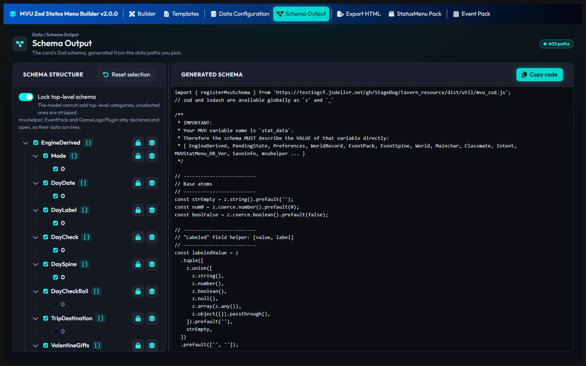

# Schema Output

The Schema Output page writes your game's Zod schema, the rules that say what can go into each variable. A number field refuses a word, and a variable you never declared can be stripped.

It shows 2 things side by side: **Schema structure**, a tree built from your sample data, and **Generated schema**, the code. You tick what goes in, and the code updates as you click. **Copy code** copies it. **Reset selection** puts every choice back the way the builder first guessed them, and asks first.

What the schema does in the game, and where it lives on the card, is on MVU Helper's [Schema](https://github.com/KritBlade/mvu-helper/blob/main/doc/gamelogic_engine/schema.md) page. With **Lock top-level schema** off, the code this page writes passes every check on that page.

## What goes in

Every variable in the tree has a checkbox. Ticked means it's in the schema. Unticked means it's left out.

Every object and every list gets 2 more buttons. Each one lights up when it's on:

| Button | Icon | What it means |
| --- | --- | --- |
| **Collection** | stacked layers | many members, all of the same shape. The cast is one: every heroine has the same fields. The schema writes that shape once, for every member |
| **Locked** | padlock | strict. Keys you didn't declare are stripped. Unlocked, they're kept |

**Turn on Collection for every list of members,** like the cast, the inventory or the quest log. The Builder page uses it too. A block that shows the cast repeats once per heroine only when the cast is a Collection.

The builder guesses all of these when the data loads. Check them anyway. A guess can't tell a list of 2 heroines from 2 fields that just happen to look alike.

## Lock top-level schema

This one is off by default, and I recommend keeping it off.

Off, the top level stays open. Anything you didn't tick still survives, including what MVU Helper and other packs add later.

On, the top level is closed. Every top-level variable you didn't tick is stripped on the next save. The builder still declares MVU Helper's own 3 for you, open: `mvuhelper`, `EventPack` and `GameLogicPlugin`. So outfit memory, event packs and plugins keep their data. Anything else that shows up later is turned away.

It's like a guest list at the door. With no list, everybody gets in. With a list, anybody not on it gets turned away, even the friends who show up late.

[Back to How to use MVU Zod Status Menu Builder](README.md)
