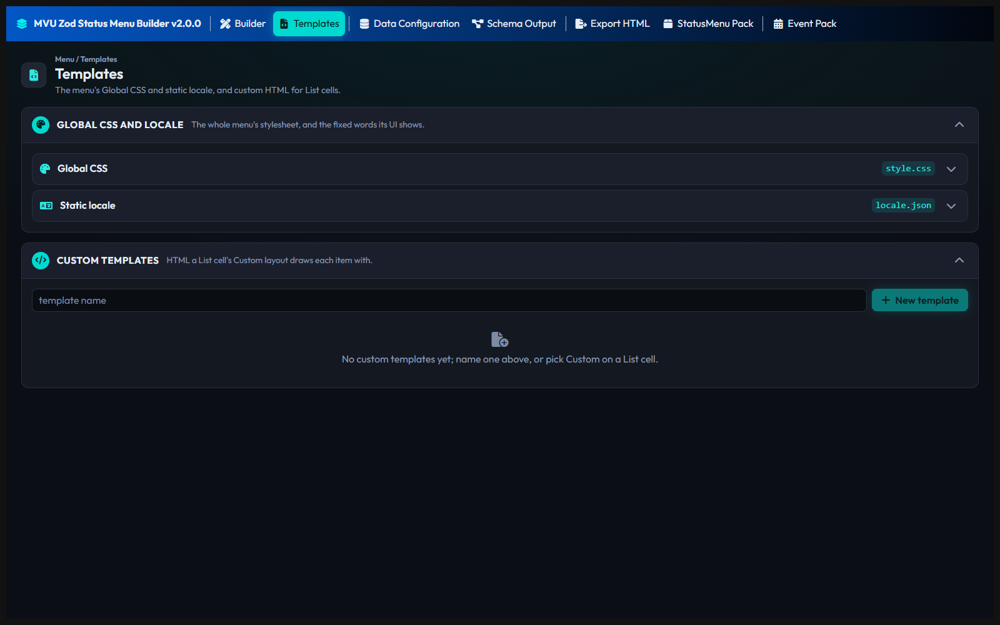

# Templates

The Templates page holds what the menu looks like, not what it shows. It has 2 cards: **Global CSS and locale**, and **Custom templates**.



## Global CSS and locale

This card has 2 rows, closed at first: **Global CSS** and **Static locale**. Click one to open it. Each has its own **Reset to default**, which asks first.

### Global CSS

Its box, **Global styles**, holds the styles of the whole menu: its colors, its fonts, its spacing. Change them here, and every tab of the menu follows.

**Reset to default** puts the builder's own styles back. Do it when the menu in SillyTavern doesn't look like the preview. A project made with an older version keeps its old CSS until you reset it.

When you export a pack, your CSS is fenced in to your menu only. So it can't restyle the chat or the rest of the card around it. One thing can't be fenced in, `@import`, and the export refuses it.

### Static locale

Its box, **Locale strings**, holds the menu's fixed text, as JSON pairs of a key and its text:

```json
{
    "empty_inventory": "Empty inventory",
    "empty_quest": "No active quests"
}
```

Translate the text here, and the menu shows it in your language. **Reset to default** puts the builder's own text back.

## Custom templates

The built-in list layouts are List, Grid, Quest, Inventory and Equipment. When none of them fits, design your own.

1. Type a name in the box, and click **New template**.
2. Write its HTML. That's how one member of the list is drawn.
3. On a List cell in the Builder page, set **Layout** to **Custom**, and type the same name.

In the HTML, `data-bind` fills in a value from the member:

```html
<div>
    <b><span data-bind="$key"></span></b>
    <span data-bind="Desc"></span>
</div>
```

`$key` is the member's key, like the quest's name. Any other name is one of the member's fields, like `Desc`.

Only the templates your exported tabs actually use go into the pack.

[Back to How to use MVU Zod Status Menu Builder](README.md)
